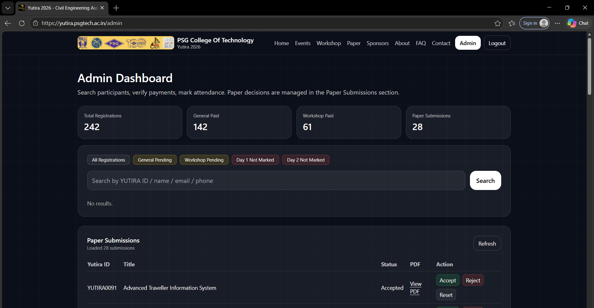

# Yutira 2026 - Event Management Platform

**Live Website:** [https://yutira.psgtech.ac.in](https://yutira.psgtech.ac.in)

A modern, full-stack web platform built for **Yutira 2026**, the national level technical symposium hosted by the Department of Civil Engineering at PSG College of Technology. 

Developed as a freelance project, this platform handles everything from attendee registration and paper submissions to payment verification and on-ground attendance tracking.



## Core Features

- **Dynamic Event Landing Page:** Features a live countdown timer, event schedule, and smooth UI transitions powered by `framer-motion`.
- **Secure Authentication:** Complete auth flow using JWT, `bcryptjs` for password hashing, and `nodemailer` for email verification and password resets.
- **Complex Registration System:** 
  - Tracks user details, college, and department.
  - Separate payment status flows for general events and specific workshops.
  - Generates unique `Yutira ID`s using a custom Counter schema.
- **Paper Submission Portal:** Students submit research papers by pasting a Google Drive share link to their abstract PDF, which admins review from the dashboard.
- **Admin Dashboard:** 
  - Track attendance for Day 1 and Day 2.
  - Approve or reject paper submissions with remarks.
  - Toggle payment statuses manually.
  - Export participant data to CSV/XLSX using `xlsx` and `csv-stringify`.

## Tech Stack

- **Framework:** Next.js 14 (App Router)
- **Database:** MongoDB (Mongoose)
- **Styling:** Tailwind CSS
- **Authentication:** JSON Web Tokens (JWT) & bcryptjs
- **Email:** Nodemailer

## Setup & Installation

1. Clone the repository and install dependencies:
   ```bash
   git clone https://github.com/jafersathikbeta/Yutira-Event-Platform.git
   cd Yutira-Event-Platform
   npm install
   ```

2. Configure your Environment Variables:
   Rename `.env.example` to `.env.local` and fill in your credentials:
   ```env
   APP_URL=http://localhost:3000
   JWT_SECRET=your_super_secret_key
   MONGODB_URI=your_mongodb_connection_string
   ADMIN_EMAIL=admin@example.com
   ADMIN_PASSWORD=change_me
   EMAIL_ENABLED=true
   SMTP_HOST=smtp.gmail.com
   SMTP_PORT=465
   SMTP_SECURE=true
   SMTP_USER=your_email@gmail.com
   SMTP_PASS=your_app_password
   SMTP_FROM_NAME=Yutira 2026
   ```

3. Run the development server:
   ```bash
   npm run dev
   ```
   Open [http://localhost:3000](http://localhost:3000) to view the site.

## Deployment

The production build is optimized for deployment on Vercel or any Node.js hosting provider. 
```bash
npm run build
npm start
``` 
 
 
 
 
 
 
 
 
 
 
 
 
 
 
 
 
 
